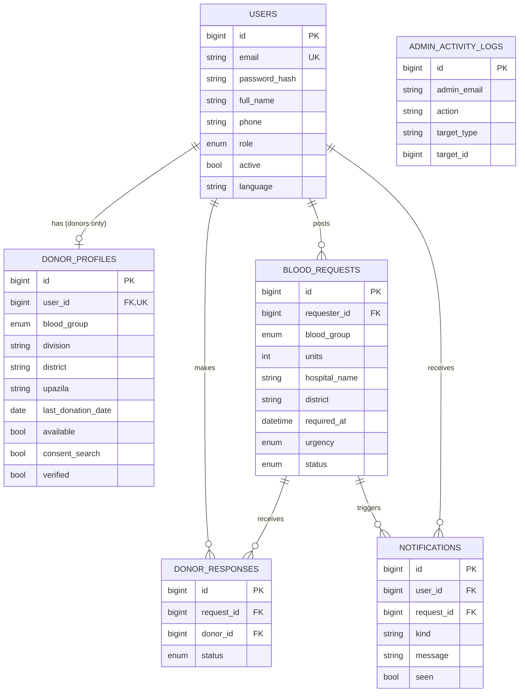

# Database

For local development, `backend\run-dev.ps1` runs the backend with a persistent H2 database in MySQL compatibility mode. Its files are stored under `backend\data` and are excluded from Git. MySQL remains the default datasource outside the `dev` Spring profile.

Tables are created automatically by Hibernate (`spring.jpa.hibernate.ddl-auto=update`) on first run.
Create an empty MySQL user/database or let `createDatabaseIfNotExist=true` do it.
For production, set `DDL_AUTO=validate` and manage schema with migrations (Flyway) instead.

## ER diagram (what is implemented in this version)

Unique constraints: `users.email`, `donor_profiles.user_id`, `(donor_responses.request_id, donor_id)`,
`(notifications.user_id, request_id, kind)` (prevents duplicate notifications).

## Not implemented yet
`Organization`, `OrganizationMember`, `Campaign`, `CampaignRegistration`, `Report`, `DonationHistory`,
and normalized `Division/District/Upazila` tables. Divisions and districts currently live in
`frontend/src/data/bd.js`, and the backend stores them as text.
